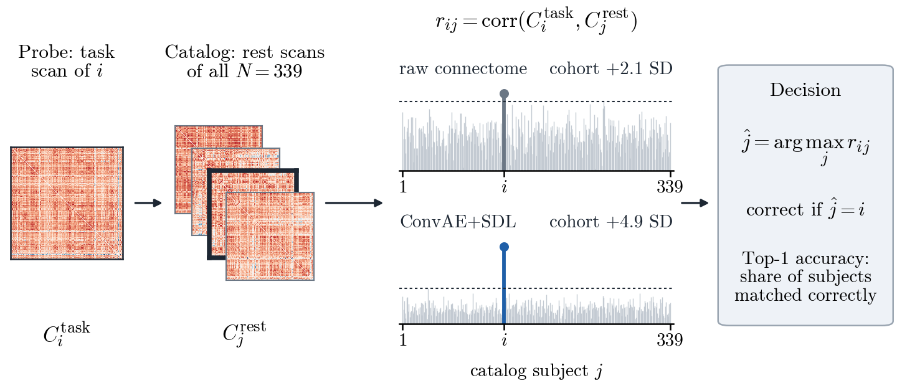
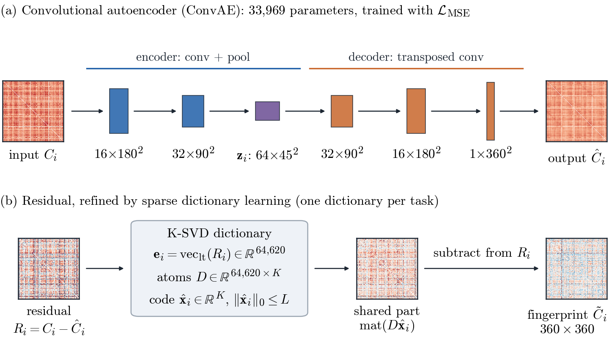
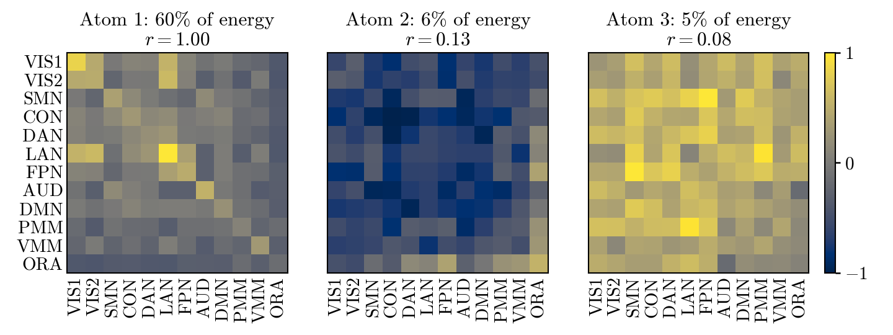

<div align="center">

# A Deep Dictionary Learning Method for Brain Fingerprinting from fMRI Connectivity

**Rickarya Das · Yashaswini Chand · Sanjay Ghosh**

Department of Electrical Engineering, Indian Institute of Technology Kharagpur

*IBI-BIBC Workshop at Brain Informatics (BI 2026), Brisbane, Australia · Springer*

[](LICENSE)
[](https://www.python.org/)
[](https://pytorch.org/)

</div>

This repository contains the official code for **ConvAE+SDL**, a two-stage framework for identifying individuals from their fMRI functional connectome. A convolutional autoencoder estimates the connectivity structure shared by the population, and sparse dictionary learning removes the shared patterns that remain in the residual. What is left is a subject-specific fingerprint that can be matched across cognitive states.

On 339 subjects of the Human Connectome Project, matching task scans against a resting-state catalog, ConvAE+SDL reaches an average identification accuracy of **73.67%** across four cognitive domains. This compares with 31.31% for correlation-based fingerprinting and 69.25% for the strongest deep-learning baseline, and the model uses **1,474× fewer parameters** than that baseline.

<div align="center">
  
  <br/>
  <sub><b>Fig. 1.</b> Connectome fingerprinting with real data (working-memory task, N = 339). Subject <i>i</i>'s task connectome is correlated with every resting-state connectome in the catalog, and the best match is the predicted identity.</sub>
</div>

---

## Method

<div align="center">
  
  <br/>
  <sub><b>Fig. 2.</b> The two-stage framework, shown with the real matrices of one subject.</sub>
</div>

1. **Convolutional autoencoder (ConvAE).** A three-layer convolutional encoder/decoder (16–32–64 filters, 33,969 parameters) treats each 360 × 360 connectome ([Glasser et al., 2016](https://doi.org/10.1038/nature18933) parcellation) as a single-channel image. Its reconstruction captures the structure shared across subjects, and the residual `C − Ĉ` keeps the subject-specific part.
2. **Sparse dictionary learning (SDL).** The lower triangles of the residuals (64,620 edges) are decomposed with K-SVD into a dictionary `D` and sparse codes `x` (orthogonal matching pursuit). The dictionary atoms describe patterns shared by all subjects, so subtracting `mat(D x̂)` gives the refined fingerprint.
3. **Identification.** The refined task connectome of each subject is correlated with the raw resting-state connectomes of all subjects, and the subject with the highest Pearson correlation is the prediction.

Both stages learn from unlabeled connectomes: subject identities are used only to score the matches.

---

## Results

All numbers are Top-1 identification accuracy (%) on the HCP S1200 subset of N = 339 subjects (task scan → resting-state catalog).

**Table 1. Comparison with baselines**

| Method | WM | Emotion | Gambling | Relational | **Average** |
|:---|:---:|:---:|:---:|:---:|:---:|
| Finn et al. (2015) | 41.74 | 28.17 | 32.30 | 23.01 | 31.31 |
| Metric-BolT (Xu et al., 2026) | 32.45 | 7.37 | 23.01 | 10.32 | 18.29 |
| Lu et al. (2024) | 76.99 | 70.50 | 74.63 | 54.87 | 69.25 |
| **ConvAE+SDL (ours)** | **76.99** | **74.04** | **75.22** | **68.44** | **73.67** |

All accuracies are significant: a permutation test with 500 shuffles of subject identities gives p = 0.002 for every task, and McNemar's test against raw connectomes gives p < 10⁻⁶.

**Generalization to held-out subjects.** In a subject-wise five-fold control, both stages are fitted on four folds, and each held-out subject is identified among all 339 resting-state scans. Held-out subjects are identified with an average accuracy of **73.31%** (WM 77.88, emotion 72.57, gambling 74.93, relational 67.85).

**Table 2. Cross-task generalization**

Rows are the training task and columns the evaluation target.

| Trained on | WM | Emotion | Gambling | Relational |
|:---|:---:|:---:|:---:|:---:|
| WM | – | 61.06 | 73.75 | 65.49 |
| Emotion | 69.62 | – | 72.27 | 61.06 |
| Gambling | 71.09 | 70.80 | – | 66.96 |
| Relational | 73.45 | 65.78 | 78.76 | – |
| **Average** | **71.39** | **65.88** | **74.93** | **64.50** |

**Table 3. Ablation**

| Variant | WM | Emotion | Gambling | Relational | **Average** |
|:---|:---:|:---:|:---:|:---:|:---:|
| Raw FC (Finn et al., 2015) | 41.74 | 28.17 | 32.30 | 23.01 | 31.31 |
| SDL only | 4.42 | 1.77 | 1.77 | 1.47 | 2.36 |
| ConvAE residuals | 53.39 | 28.61 | 40.41 | 28.02 | 37.61 |
| **ConvAE+SDL** | **76.99** | **74.04** | **75.22** | **68.44** | **73.67** |

**Table 4. Computational complexity**

| Method | Params (M) | MACs (M) | Train (s) | Inference (ms) |
|:---|:---:|:---:|:---:|:---:|
| Raw FC (Finn et al., 2015) | 0.00 | 0.0 | 0.00 | 9.18 |
| Metric-BolT | 5.24 | 3576.6 | 196.26 | 22.25 |
| Lu et al. (2024) | 50.06 | 421.1 | 25.07 | 1.28 |
| **ConvAE+SDL (ours)** | **0.03** | **352.5** | **14.03** | **0.74** |

<div align="center">
  
  <br/>
  <sub><b>Fig. 3.</b> The three strongest dictionary atoms of the working-memory task, averaged within and between twelve functional networks. The atoms are population-wide patterns, which is why subtracting them sharpens the individual fingerprint.</sub>
</div>

---

## Repository structure

```
Brain-Fingerprinting/
├── ConvAE_SDL/
│   ├── ConvAE_SDL.py               # Main experiment: Table 1, ablation (Table 3), statistics
│   └── ConvAE_SDL_CrossTask.py     # Cross-task generalization (Table 2)
├── experiments/
│   ├── reproduce_paper.py          # Seeded re-run of Tables 1-3 and the held-out control
│   ├── crosstask_factors.py        # Analysis of what drives cross-task transfer
│   ├── make_figures.py             # Figures 1-3 of the paper, drawn from the data
│   └── reference/                  # Our results for the scripts above (JSON)
├── Baselines/
│   ├── CVAE_SDL/                   # Lu et al. (2024): conv_cvae_sdl.py is the reported variant
│   └── metric_learning/            # Metric-BolT (Xu et al., 2026)
├── src/                            # Reusable implementation
│   ├── models/                     # ConvAE, K-SVD / OMP, Finn et al. baseline
│   ├── analysis/                   # Metrics, statistics, ablation, cross-validation, robustness
│   ├── processing/                 # Connectome generation and refinement
│   ├── data/download_hcp_data.py   # Downloads the HCP data used in the paper
│   ├── utils/  visualization/
│   ├── train_model.py
│   └── demo_pipeline.py            # Self-contained demo on synthetic data
├── tests/                          # Unit tests
├── config/basic_parameters.txt     # Data location and HCP run names
└── docs/figures/                   # Figures used in this README
```

---

## Installation

```bash
git clone https://github.com/ridash2005/Brain-Fingerprinting.git
cd Brain-Fingerprinting
pip install -r requirements.txt
```

A CUDA GPU is recommended for the baselines. ConvAE+SDL also runs on a CPU; `experiments/reproduce_paper.py` is batched to fit in 8 GB of RAM.

Check the installation with the synthetic-data demo and the unit tests:

```bash
python src/demo_pipeline.py      # full ConvAE + K-SVD pipeline on synthetic data
python -m pytest tests
```

The demo uses easily separable synthetic subjects, so its accuracies only show that the pipeline runs. They say nothing about real data.

---

## Data

The experiments use the **339 healthy young adults of the HCP S1200 release** that [Neuromatch Academy](https://github.com/NeuromatchAcademy/course-content/tree/main/projects/fMRI) distributes in parcellated form (360 Glasser regions, minimally preprocessed). Every subject has all resting-state and task runs.

The data are covered by the [HCP Open Access Data Use Terms](https://www.humanconnectome.org/study/hcp-young-adult/document/wu-minn-hcp-consortium-open-access-data-use-terms). This repository does not redistribute any data, connectomes, or trained models derived from it.

**1. Download** the Neuromatch HCP files (about 3 GB) into `DATA/`:

```bash
python src/data/download_hcp_data.py
```

**2. Compute the connectomes** into `FC_DATA/fc_<task>.npy` (one 339 × 360 × 360 array per condition):

```bash
for task in rest wm emotion gambling relational; do
    python src/processing/generate_whole_brain_fc.py -task $task
done
```

This reproduces the connectomes used in the paper exactly, including the subject order. Both scripts read `HCP_DIR` and `N_SUBJECTS` from [config/basic_parameters.txt](config/basic_parameters.txt).

---

## Reproducing the paper

Run every command from the repository root once `FC_DATA/` is in place.

| Paper result | Command |
|:---|:---|
| Tables 1 and 3, statistics | `python ConvAE_SDL/ConvAE_SDL.py` |
| Table 2 (cross-task) | `python ConvAE_SDL/ConvAE_SDL_CrossTask.py` |
| Seeded re-run, held-out control, cross-task analysis | `python experiments/reproduce_paper.py A B D A2` |
| Determinants of cross-task transfer | `python experiments/crosstask_factors.py` |
| Figures 1–3 | `python experiments/make_figures.py` |
| Lu et al. (2024) baseline | `python Baselines/CVAE_SDL/conv_cvae_sdl.py --task all` |
| Metric-BolT baseline | `python Baselines/metric_learning/metric_bolt_baseline.py --task all` |

Notes:

- The two `ConvAE_SDL/` scripts are the ones that produced the published numbers. They loop over all seven HCP tasks; the paper reports working memory, emotion, gambling and relational.
- The original training run was not seeded. `experiments/reproduce_paper.py` repeats it with fixed seeds and gives 72.28% on average, against the 73.67% in Table 1. Our outputs of these scripts are in [experiments/reference/](experiments/reference), and new runs are written to `experiments/output/`.
- The Metric-BolT baseline clones the [official MetricBolT code](https://github.com/CAIMI-WEIGroup/MetricBolT) on first use.

**Hyperparameters.** ConvAE: Adam (lr = 10⁻³, β = (0.9, 0.999)), batch size 16, 20 epochs, MSE loss, PyTorch default initialization. K-SVD: 5 iterations (10 for cross-task), with dictionary size and sparsity (K, L) set per task:

| Task | WM | Emotion | Gambling | Relational |
|:---|:---:|:---:|:---:|:---:|
| (K, L) | (15, 13) | (15, 13) | (14, 11) | (11, 9) |

---

## Citation

If you use this code, please cite:

```bibtex
@inproceedings{das2026deep,
  title     = {A Deep Dictionary Learning Method for Brain Fingerprinting from {fMRI} Connectivity},
  author    = {Das, Rickarya and Chand, Yashaswini and Ghosh, Sanjay},
  booktitle = {Brain Informatics (BI 2026)},
  publisher = {Springer},
  year      = {2026}
}
```

---

## Acknowledgments

This work is supported by the Faculty Start-up Research Grant (FSRG), IIT Kharagpur, awarded to Dr. Sanjay Ghosh.

Data were provided by the Human Connectome Project, WU-Minn Consortium (Principal Investigators: David Van Essen and Kamil Ugurbil; 1U54MH091657) funded by the 16 NIH Institutes and Centers that support the NIH Blueprint for Neuroscience Research; and by the McDonnell Center for Systems Neuroscience at Washington University.

## License

The code is released under the [MIT License](LICENSE).

## Contact

For questions about the paper, contact the corresponding author, Sanjay Ghosh (sanjay.ghosh@ee.iitkgp.ac.in). For problems with the code, please [open an issue](https://github.com/ridash2005/Brain-Fingerprinting/issues).
